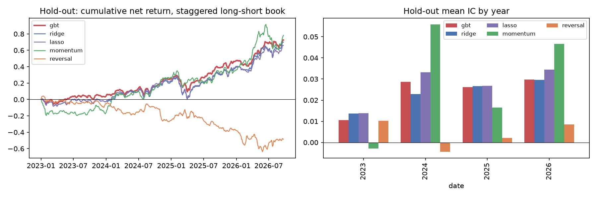
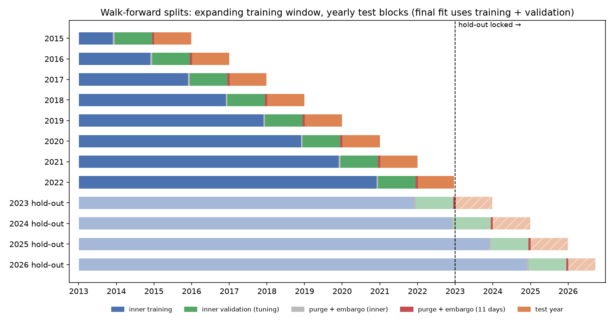

# Machine-Learning Alpha Signal (S&P 500)

Cross-sectional prediction of weekly stock returns with ridge, lasso and gradient-boosted trees, built around
leakage control: a pre-registered design ([DESIGN.md](DESIGN.md)), purged walk-forward splits, placebo and
future-perturbation tests, and a hold-out period locked until one final run.

## Summary

**Question:** can a machine-learning model on standard price and volume features rank S&P 500 stocks well enough
to earn money after trading costs, when tested without leakage?

**Method:**
- **Data:** today's S&P 500 members, daily prices 2012 – Sep 2026 (Yahoo snapshot, frozen; not redistributed), cleaned with a
  logged, deterministic step.
- **Features:** 12 pre-registered features (momentum, reversal, 52-week high, volatility, beta, volume trend,
  illiquidity, size), ranked across stocks each day. **Label:** the 5-day return from the close *after* the
  signal, relative to other stocks.
- **Models:** ridge, lasso and gradient-boosted trees (the primary model, fixed in advance), retrained yearly on an
  expanding window with an 11-day purge and embargo, tuned only on the 12 months before each test year.
- **Evaluation:** IC, decile spreads, and a weekly top-minus-bottom decile long-short book with liquidity-based
  costs and borrow fees, against momentum and reversal baselines.
- **Development 2013–2022 (out-of-sample walk-forward test years 2015–2022); hold-out 2023 – Sep 2026 run once** on code frozen
  after the robustness checks.

**Headline results:**
- **Leakage controls hold:** features and predictions are unchanged when every future price is scrambled, and a
  planted look-ahead feature is caught.
- **Development (2015–2022): no tradable edge.** Primary model IC +0.013 (not significant after correcting for 5
  signals), net Sharpe +0.21, 95% interval including 0; no better than plain 1-month reversal.
- **The apparent signal comes from survivorship bias.** It sits in stocks that joined the index later; on stocks
  that were members throughout, the development IC is +0.003. Shuffled-label placebo models reach ICs as large as
  the real one, so the usual t-statistics overstate confidence.
- **Hold-out (2023 – Sep 2026): net Sharpe +1.05 [+0.02, +2.07], but the bias explains it.** The 61 stocks that
  joined the index *during* the hold-out beat the rest by about 45 bps a week (that is why they were added), and
  the model's IC on them is +0.043, against +0.019 on long-time members, where the market-hedged net Sharpe is
  −0.10. Plain 12-month momentum did about as well as the model.

**Main limitation:** no free point-in-time index membership. With today's members as the universe, any signal
that favours small or rising stocks is flattered; a clean test needs CRSP-style membership and delisting data.



## Data card

| | |
|---|---|
| **Universe** | Today's S&P 500 members (Wikipedia snapshot of 2026-10-14: 503 tickers; 502 with prices, VYLR has none) plus SPY as the market. |
| **Prices** | Daily open, high, low, close, adjusted close and volume from Yahoo Finance via `yfinance` (`auto_adjust=False`), 2012-01-03 to 2026-09-30, 3,707 trading days, 1,768,517 rows. Fetched 2026-10-14 23:05 UTC. |
| **Snapshot** | `data/raw/prices_20261014T230531Z.parquet` (+ `.json` metadata) and `sp500_constituents_20261014.csv`, never edited. Every result is computed from it. The price file is not in this repo because Yahoo data may not be redistributed; `make fetch` downloads a fresh one (Yahoo revises history, so numbers can differ slightly). SHA-256 of the original: `2a38bd67686ce8467651004f3a36b43883172d0e892793b8342e097d343e8438`. |
| **Periods** | 2012 feeds lookback features only. Development 2013-01-01 to 2022-12-31 (all model choices). Hold-out 2023-01-01 to 2026-09-30, locked: data-quality checks only until the single final run. |
| **Cleaning** | `alpha.data.clean`, deterministic and logged: drops placeholder history before the current listing (SW before 2024-07, FERG before 2021-03, AMCR before 2019-06, HWM, VRT, GDDY, P), drops the remaining zero-volume days, and repairs one broken adjustment (DHR, Fortive spin-off 2016-07-05: +61% adjusted vs +3.6% actual). |
| **Quality after cleaning** | Coverage after each stock's first price: median 100%, minimum 99.56%. 0 stale-price runs (329 before cleaning). 41 one-day moves beyond ±40% (log), none with a split or adjustment signature after cleaning; they are kept, and include known events such as the 9 March 2020 oil crash (six energy stocks) and the PCG bankruptcy filing. Each is listed in the report for review. |
| **Liquidity** | Median daily dollar volume over the development period: median $143m per stock; 7 of 492 below $10m (lowest ERIE $4.7m). |
| **Known biases** | **Survivorship:** stocks that left the index since 2012 are missing. **Membership look-ahead:** 206 of 503 members (41%) joined after 2013 and are used before they joined, having been added because they grew. Both favour past winners and flatter momentum; no free point-in-time membership list exists, so every result carries this caveat. Yahoo history is revised over time, which is why the snapshot is frozen. |
| **Licence** | Yahoo Finance data is for personal research use; `yfinance` is community-maintained and not affiliated with Yahoo. |

Evidence: [reports/phase1_data.md](reports/phase1_data.md) (every cleaning action, every large move, liquidity),
[figures/phase1_coverage.png](figures/phase1_coverage.png).

## Split design



```
 one fold (test year Y), on the trading calendar:

 2013-01-02 ............................................ | 11 days | Y-01-02 ........ Y-12-31
 [ inner training ] [5+5 gap] [ inner validation, 12 m ] [ purge  ] [ test year (out of sample) ]
 \________________ training window: final refit on all of it ___/  [+embargo]
```

- **Expanding window, yearly test blocks:** 8 development folds (test years 2015–2022), then 4 hold-out
  folds (2023 to Sep 2026) run once at the end, with the identical, frozen procedure.
- **Purge + embargo:** the label covers 5 days, so a training date is kept only if its label ends at least
  5 more trading days (the embargo) before the test year starts: 11 trading days separate the last
  training date from the first test date. The same gap separates inner training from inner validation.
- **Tuning:** hyperparameters are picked on the last 12 months of each training window, then the model is
  refitted on the whole window. Test years never inform any choice.
- **Hold-out stays clean:** development test labels end by 2022-12-30 (the last 6 trading days of 2022 are
  not tested), so no development result uses a 2023 price.
- Fold-by-fold dates and sample counts: [reports/phase3_splits.md](reports/phase3_splits.md).

## Results

| Phase | Result |
|---|---|
| [1. Data and universe](reports/phase1_data.md) | Snapshot frozen; three data faults found and fixed with a logged cleaning step (stale flags 329 → 0); biases stated. |
| [2. Features and label](reports/phase2_features.md) | 12 pre-registered features (momentum, reversal, 52-week high, volatility, beta, idiosyncratic volatility, volume trend, illiquidity, size proxy), rank-normalised per date; label = 5-day excess return from close t+1, trained as its rank. 1.63M eligible stock-days. Leakage tests pass: features unchanged when the future is removed (unit tests and three real dates), label depends only on closes t+1 and t+6, a planted look-ahead feature is caught. |
| [3. Split design](reports/phase3_splits.md) | 8 development + 4 hold-out walk-forward folds with purge and a 5-day embargo, checked on the real calendar and by unit tests (tight purge, disjoint test years, gap scales with the horizon). Development labels never touch 2023 prices. |
| [4. Models](reports/phase4_models.md) | Ridge, lasso and gradient-boosted trees (primary, fixed in advance) tuned per fold on inner validation; out-of-sample predictions saved for all 939,365 test stock-days 2015–2022 (`predictions/dev_predictions.parquet`), with no gaps. 96 tuning fits logged in `reports/trials.csv`. Validation ICs are small (0.00–0.04), as expected for weekly stock returns. [Figure](figures/phase4_models.png). |
| [5. Evaluation](reports/phase5_evaluation.md) | Development test years 2015–2022, net of costs. Primary gbt: IC +0.013 (t = 2.29, not significant after Bonferroni for 5 signals), deciles rise steadily, OOS R² slightly negative. Top-minus-bottom decile book: net Sharpe +0.21, +0.11 after hedging its market beta (+0.5); all 95% intervals include 0; gains come mostly from 2017 and 2020. No better than plain 1-month reversal. **No evidence of a tradable edge after costs in development.** |
| [6. Robustness](reports/phase6_robustness.md) | Reproducibility and whole-pipeline future perturbation **pass**. Placebo: **2 of 6 shuffled-label runs fail** (both negative, so not leakage): noise-fitted models reach ICs as large as the real one, so Phase 5's t-statistics understate uncertainty. Most important features: size/liquidity, then reversal. **On stocks in the index since 2012 the IC is +0.003 (t 0.5); the signal sits in later joiners (+0.019)**, i.e. in the membership look-ahead. No variant (horizons 1/21, fixed hyperparameters, costs, breadth, universe) has a net Sharpe interval above 0. [Figure](figures/phase6_robustness.png). |
| [7. Hold-out](reports/phase7_holdout.md) | Frozen pipeline (commit `e794eeb`, checked by the script) run once on 2023 – Sep 2026. gbt IC +0.023 (t 2.46, Bonferroni p 0.07), net Sharpe +1.05 [+0.02, +2.07], +0.59 hedged; momentum about as good (IC +0.028), reversal failed. Split by join date: IC +0.043 on the 61 stocks that joined during the hold-out vs +0.019 on long-time members (hedged net Sharpe −0.10). **Inflated by membership look-ahead; no edge that survives the known biases.** |

## Validation

- **39 unit tests** (`pytest`), including:
  - data: large moves and stale prices flagged, splits recognised, placeholder history and broken adjustments repaired;
  - leakage: features unchanged when data after t are removed or perturbed; the label depends only on closes
    t+1 and t+1+h; a planted look-ahead feature is caught;
  - splits: tight purge and embargo, disjoint test years, no development label reaching 2023;
  - models: a planted linear and non-linear signal recovered, no IC on noise, test labels never used in fitting;
  - evaluation: Newey-West t-statistics, turnover and cost accounting, portfolio beta, deciles, R².
- **Whole-pipeline checks (Phase 6):** reproduction of saved predictions, future perturbation of the raw data,
  shuffled-label placebos (2 of 6 failed and are reported), permutation importance, sensitivity to horizon,
  hyperparameters, costs, breadth and universe.
- **Pre-registration:** every design choice was committed before the results it affects; later additions are
  logged in [DESIGN.md](DESIGN.md) under "Changes", none of which changed a pre-registered number.
- **Multiple testing:** every tuning fit is logged ([reports/trials.csv](reports/trials.csv)); IC p-values are
  Bonferroni-adjusted for the 5 signals compared.

## Limitations

- **Survivorship and membership look-ahead** (the main one, measured in Phases 6 and 7): stocks that left the index
  are missing and later joiners are included before they joined.
- **Size is proxied by dollar volume:** free point-in-time shares outstanding were not available.
- **Uncertainty is understated:** placebo models show that 5-lag Newey-West and Lo (2002) intervals are too narrow
  for factor-like signals.
- **Costs are modelled, not measured:** spread plus a liquidity term, no market impact beyond it; drift within the
  week is ignored in turnover.
- **One data source** (Yahoo via `yfinance`), revised over time; the frozen snapshot (checksum above) fixes what was used.

## Reproducibility

```bash
make all      # create .venv, install pinned deps, run tests, regenerate every report and figure (~35 min, offline once the snapshot is in data/raw)
make fetch    # optional: download a fresh snapshot (analyses always use the newest one in data/raw)
```

- **Dependencies:** pinned in `requirements.txt`. Python 3.13.
- **Data:** the Yahoo price snapshot is not redistributed; `make fetch` puts a fresh one in `data/raw/` (the S&P list is
  committed). Derived files go to `data/processed/` (not in git). Git history was rewritten on 2026-11-10 to remove
  the data: commits, dates and code are unchanged, IDs changed (frozen commit `1b30cb4` is now `e794eeb`).
- **Hold-out guard:** `scripts/run_holdout.py` refuses to run unless `src/alpha/` matches the frozen commit, and
  keeps the first-run time in `reports/holdout_run.json`; re-runs reproduce the same predictions.
- **Seeds:** gradient-boosted trees use `random_state=0`; shuffles and perturbations use fixed seeds.
- **CI:** `.github/workflows/ci.yml` runs the tests and a full `make all`.

```
src/alpha/   data (snapshot, cleaning), features, splits, models, evaluate, robust
scripts/     fetch_data.py, run_phase1.py … run_phase6.py, make_phase4_figure.py, run_holdout.py
tests/       unit tests per module
reports/     one report per phase, trials.csv, holdout_run.json     figures/   every figure
predictions/ out-of-sample predictions: development (2015–2022) and hold-out (2023 – Sep 2026)
```

## References

- Gu, Kelly & Xiu (2020), *Empirical Asset Pricing via Machine Learning*, Review of Financial Studies 33(5).
- López de Prado (2018), *Advances in Financial Machine Learning*, Wiley (purging and embargo).
- Jegadeesh & Titman (1993), *Returns to Buying Winners and Selling Losers*, Journal of Finance 48(1).
- Jegadeesh (1990), *Evidence of Predictable Behavior of Security Returns*, Journal of Finance 45(3).
- Amihud (2002), *Illiquidity and stock returns*, Journal of Financial Markets 5(1).
- Newey & West (1987), *A Simple, Positive Semi-Definite, Heteroskedasticity and Autocorrelation Consistent
  Covariance Matrix*, Econometrica 55(3).
- Lo (2002), *The Statistics of Sharpe Ratios*, Financial Analysts Journal 58(4).
