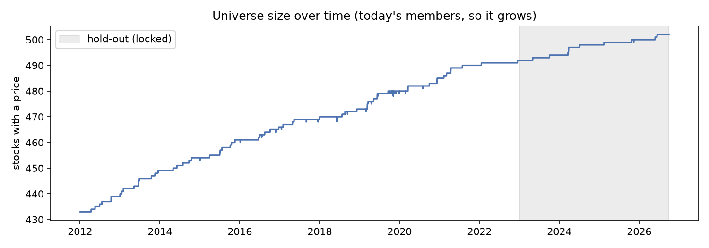

# Phase 1: data and universe

- Constituents: `sp500_constituents_20261014.csv`, 503 tickers (today's S&P 500, from Wikipedia).
- Prices: `prices_20261014T230531Z.parquet` (fetched 2026-10-14T23:05:31 UTC; Yahoo Finance via yfinance (auto_adjust=False)), 1,768,517 daily rows, 2012-01-01 to 2026-09-30, 3,707 trading days.
- Tickers with no data: 1 (VYLR).
- Development period 2013-01-01 to 2022-12-31; hold-out from 2023-01-01 (locked: data-quality checks only).

## 1. Universe and its biases

| Sector | Stocks |
|---|---|
| Industrials | 83 |
| Financials | 76 |
| Information Technology | 75 |
| Health Care | 60 |
| Consumer Discretionary | 47 |
| Consumer Staples | 34 |
| Utilities | 31 |
| Real Estate | 30 |
| Materials | 24 |
| Communication Services | 22 |
| Energy | 21 |

**Survivorship and membership look-ahead.** The universe is today's members. Stocks that left the index since 2012 (acquired, bankrupt or demoted) are missing, and **206 of 503 current members (41%) joined the index after 2013**: they are included before they were members, and they were added *because* they had grown. Both effects tilt the universe towards past winners, which flatters any signal that buys recent winners (momentum). A point-in-time membership list (e.g. CRSP) would fix this; it is not freely available, so the bias is stated in every result.

**Late listings:** 69 stocks have no prices in early 2012 (IPOs or spin-offs since), e.g. SW (2024-07), SNDK (2025-02), Q (2025-10), FDXF (2026-05), HONA (2026-06). They enter the model only once they have enough history for their features.

## 2. Data quality

The raw snapshot is never edited. `data.clean` applies three deterministic fixes, each logged:

| Ticker | Date | Action | Detail |
|---|---|---|---|
| DHR | 2016-07-05 | adjustment repaired | adjusted return +61.2% replaced by unadjusted +3.6% |
| AMCR | 2019-06-10 | placeholder history dropped | 1778 rows up to 2019-06-10 |
| FERG | 2021-03-05 | placeholder history dropped | 2308 rows up to 2021-03-05 |
| GDDY | 2015-03-31 | placeholder history dropped | 1 rows up to 2015-03-31 |
| HWM | 2016-12-22 | placeholder history dropped | 37 rows up to 2016-12-22 |
| P | 2015-10-06 | placeholder history dropped | 1 rows up to 2015-10-06 |
| SW | 2024-07-05 | placeholder history dropped | 3146 rows up to 2024-07-05 |
| VRT | 2018-08-20 | placeholder history dropped | 13 rows up to 2018-08-20 |
| AMD | 2015-01-02 | zero-volume days dropped | 1 rows |
| BKR | 2019-10-18 | zero-volume days dropped | 1 rows |
| CCI | 2020-07-31 | zero-volume days dropped | 1 rows |
| CHD | 2019-12-31 | zero-volume days dropped | 1 rows |
| CNC | 2020-02-26 | zero-volume days dropped | 1 rows |
| DOC | 2019-11-05 | zero-volume days dropped | 1 rows |
| DXCM | 2016-07-21 | zero-volume days dropped | 1 rows |
| ERIE | 2013-12-13 | zero-volume days dropped | 1 rows |
| GEN | 2019-11-05 | zero-volume days dropped | 1 rows |
| HUBB | 2017-09-01 | zero-volume days dropped | 1 rows |
| IBKR | 2019-10-07 | zero-volume days dropped | 2 rows |
| PFG | 2017-12-18 | zero-volume days dropped | 2 rows |
| SBAC | 2017-01-17 | zero-volume days dropped | 1 rows |
| VRT | 2018-09-13 | zero-volume days dropped | 9 rows |
| VST | 2016-11-25 | zero-volume days dropped | 1 rows |
| WTW | 2016-01-06 | zero-volume days dropped | 1 rows |
| XEL | 2018-06-08 | zero-volume days dropped | 1 rows |

Checks on the cleaned data (raw snapshot in brackets):

| Check | Result |
|---|---|
| Stocks with prices | 502 (+ SPY) |
| Coverage after each stock's first price (median / minimum) | 100.00% / 99.56% (VRT) |
| Stocks with missing days after listing | 18 (1) |
| Stale prices (5+ unchanged closes) | 0 (329) |
| One-day moves beyond ±40% (log) | 41 (42) |

Large one-day moves (kept: real events matter for the model; flagged so they can be checked):

| Date | Ticker | Detail | Period |
|---|---|---|---|
| 2012-05-07 | VRTX | log return +44.1% | development |
| 2013-04-19 | VRTX | log return +48.2% | development |
| 2014-05-16 | TKO | log return -57.0% | development |
| 2016-02-08 | WMB | log return -42.8% | development |
| 2016-04-22 | AMD | log return +42.1% | development |
| 2018-05-11 | GEN | log return -40.2% | development |
| 2018-10-04 | SMCI | log return -53.0% | development |
| 2018-10-26 | FLEX | log return -43.1% | development |
| 2018-11-12 | LITE | log return -40.0% | development |
| 2019-01-14 | PCG | log return -74.1% | development |
| 2019-01-24 | PCG | log return +55.7% | development |
| 2019-08-13 | BE | log return -55.3% | development |
| 2020-03-09 | APA | log return -77.4% | development |
| 2020-03-09 | HAL | log return -47.2% | development |
| 2020-03-09 | OKE | log return -47.4% | development |
| 2020-03-09 | TRGP | log return -75.3% | development |
| 2020-03-09 | OXY | log return -73.4% | development |
| 2020-03-09 | FANG | log return -59.1% | development |
| 2020-03-09 | DVN | log return -46.8% | development |
| 2020-03-12 | NCLH | log return -44.3% | development |
| 2020-03-16 | MGM | log return -41.0% | development |
| 2020-03-18 | TRGP | log return -42.2% | development |
| 2020-04-01 | CCL | log return -40.3% | development |
| 2021-08-04 | HOOD | log return +40.8% | development |
| 2022-02-23 | VRT | log return -45.8% | development |
| 2022-04-20 | NFLX | log return -43.3% | development |
| 2022-11-04 | CVNA | log return -49.4% | development |
| 2022-11-04 | TWLO | log return -42.5% | development |
| 2022-12-07 | CVNA | log return -56.1% | development |
| 2023-06-08 | CVNA | log return +44.5% | hold-out |
| 2024-04-11 | GL | log return -75.8% | hold-out |
| 2024-07-26 | DXCM | log return -52.2% | hold-out |
| 2024-11-15 | BE | log return +46.5% | hold-out |
| 2025-02-13 | WST | log return -48.2% | hold-out |
| 2025-07-02 | CNC | log return -51.7% | hold-out |
| 2025-07-31 | ALGN | log return -45.6% | hold-out |
| 2025-08-26 | ECHO | log return +53.2% | hold-out |
| 2025-09-10 | SNPS | log return -44.4% | hold-out |
| 2025-10-29 | FISV | log return -58.1% | hold-out |
| 2026-03-20 | SMCI | log return -40.5% | hold-out |
| 2026-08-19 | MRNA | log return +101.9% | hold-out |

## 3. Liquidity (development period)

Median daily dollar volume per stock (cleaned data): lowest 4.7m (ERIE), median 143m, highest 6,343m (AAPL). 7 of 492 stocks trade under $10m a day in this period (ERIE 4.7m, TPL 6.5m, FERG 7.9m, SMCI 8.1m, ECHO 8.1m, FIX 8.1m, ARES 9.2m): smaller companies, or (FERG) mainly traded abroad, before they joined the index (the look-ahead above). Phase 5 therefore uses costs that rise for less liquid stocks rather than one flat figure.

