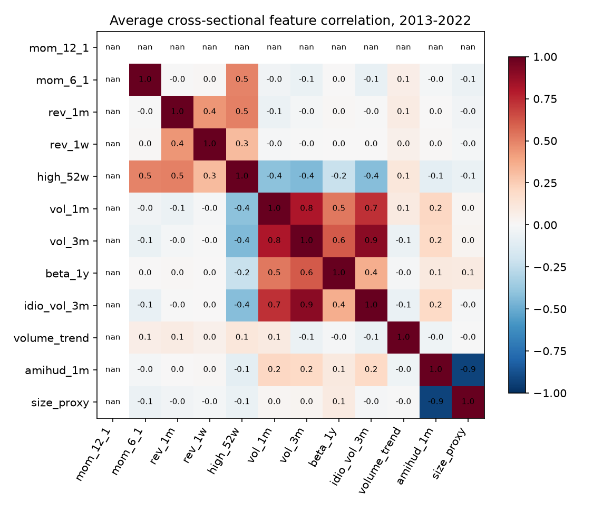
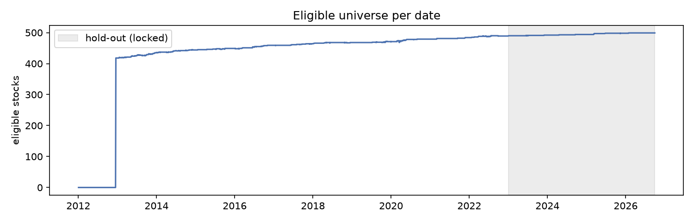

# Phase 2: features and label

Built 12 features and the 5-day label for 1,628,975 eligible stock-days (3,467 dates) in 8 s. Definitions are pre-registered in [DESIGN.md](../DESIGN.md); code in `src/alpha/features.py`.

## 1. Leakage check on the real data

Features are recomputed from data cut off at the close of date t and compared with the full-sample values at t (raw values, eligibility and normalised ranks). Any use of later data would show up as a difference.

| Cut-off date t | Eligible stocks | Values compared | Max abs difference | Result |
|---|---|---|---|---|
| 2015-06-30 | 447 | 10,824 | 0.0e+00 | pass |
| 2019-03-29 | 468 | 11,293 | 0.0e+00 | pass |
| 2022-06-30 | 487 | 11,741 | 0.0e+00 | pass |

All dates pass: features at t do not change when everything after t is removed. The unit tests (`tests/test_features.py`) add: the same with prices after t randomly perturbed; the label at t changes only when the closes at t+1 or t+1+5 change; and a planted look-ahead feature is caught.

## 2. Eligible universe

Eligible stocks per date (development period): 418 to 490, median 464. It grows because the universe is today's members (Phase 1). Of 21,350 stock-days with a price but not eligible, 63% have under 240 returns in the past year (recent listings) and 37% only fail the $5 price floor.

## 3. Feature coverage (development period, eligible stock-days)

| Feature | Missing before fill | Median | 5th / 95th percentile (raw) |
|---|---|---|---|
| mom_12_1 | 0.13% | 0.1364 | -0.2939 / 0.5263 |
| mom_6_1 | 0.00% | 0.06376 | -0.235 / 0.3189 |
| rev_1m | 0.00% | 0.01506 | -0.1218 / 0.135 |
| rev_1w | 0.00% | 0.004028 | -0.06373 / 0.06397 |
| high_52w | 0.00% | -0.07106 | -0.4288 / 0 |
| vol_1m | 0.00% | 0.01432 | 0.007142 / 0.03493 |
| vol_3m | 0.00% | 0.01508 | 0.008415 / 0.03542 |
| beta_1y | 0.00% | 0.9981 | 0.4223 / 1.641 |
| idio_vol_3m | 0.00% | 0.01228 | 0.006671 / 0.02772 |
| volume_trend | 0.00% | -0.05072 | -0.4848 / 0.4862 |
| amihud_1m | 0.00% | -9.546 | -11.51 / -7.771 |
| size_proxy | 0.00% | 18.75 | 17 / 20.55 |

## 4. Feature correlations

Average cross-sectional correlation of the rank-normalised features. Most correlated pairs:

| Pair | Correlation |
|---|---|
| amihud_1m / size_proxy | -0.93 |
| vol_3m / idio_vol_3m | +0.90 |
| vol_1m / vol_3m | +0.81 |
| vol_1m / idio_vol_3m | +0.73 |
| vol_3m / beta_1y | +0.62 |
| vol_1m / beta_1y | +0.53 |

The volatility features, and size with illiquidity, carry overlapping information. All are kept (no selection on results, as pre-registered); ridge and trees handle correlated inputs, and Phase 6 permutation importance is grouped by feature family for this reason.

## 5. Label

5-day excess log return from close t+1 to close t+6 (development period, 1,160,326 values): sd 3.60%, 1st / 99th percentile -10.1% / +9.8%, kurtosis 22. The fat tails are why models train on the cross-sectional rank instead (uniform on [-0.5, 0.5]); the raw value is kept for R² and portfolio returns. Labels overlap for 5 days, so Phase 3 purges and embargoes around every split.

