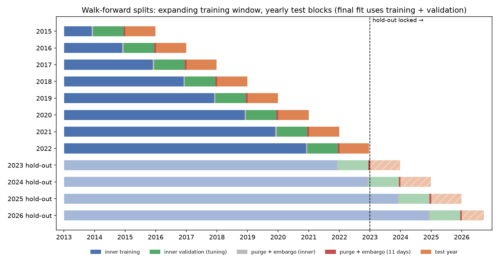

# Phase 3: split design

Walk-forward with an expanding training window, yearly test blocks, purge and embargo for the 5-day label (rules pre-registered in [DESIGN.md](../DESIGN.md); code in `src/alpha/splits.py`).

## Development folds

| Test year | Training dates | Last training date | Inner validation | Test dates | First / last test date | Train / test stock-days | Untouched trading days between last training label and test (embargo = 5) |
|---|---|---|---|---|---|---|---|
| 2015 | 493 (2013-01-02 →) | 2014-12-15 | 2013-12-16 → 2014-12-15 | 252 | 2015-01-02 / 2015-12-31 | 213,183 / 112,594 | 5 (inner 5) |
| 2016 | 745 (2013-01-02 →) | 2015-12-15 | 2014-12-16 → 2015-12-15 | 252 | 2016-01-04 / 2016-12-30 | 325,722 / 114,326 | 5 (inner 5) |
| 2017 | 997 (2013-01-02 →) | 2016-12-14 | 2015-12-15 → 2016-12-14 | 251 | 2017-01-03 / 2017-12-29 | 439,938 / 115,702 | 5 (inner 5) |
| 2018 | 1,248 (2013-01-02 →) | 2017-12-13 | 2016-12-14 → 2017-12-13 | 251 | 2018-01-02 / 2018-12-31 | 555,586 / 117,280 | 5 (inner 5) |
| 2019 | 1,499 (2013-01-02 →) | 2018-12-13 | 2017-12-14 → 2018-12-13 | 252 | 2019-01-02 / 2019-12-31 | 672,821 / 118,136 | 5 (inner 5) |
| 2020 | 1,751 (2013-01-02 →) | 2019-12-13 | 2018-12-14 → 2019-12-13 | 253 | 2020-01-02 / 2020-12-31 | 790,925 / 120,505 | 5 (inner 5) |
| 2021 | 2,004 (2013-01-02 →) | 2020-12-15 | 2019-12-16 → 2020-12-15 | 252 | 2021-01-04 / 2021-12-31 | 911,341 / 121,264 | 5 (inner 5) |
| 2022 | 2,256 (2013-01-02 →) | 2021-12-15 | 2020-12-16 → 2021-12-15 | 245 | 2022-01-03 / 2022-12-21 | 1,032,550 / 119,558 | 5 (inner 5) |

## Hold-out folds (dates only; run once, after Phase 6)

| Test year | Training dates | Last training date | Inner validation | Test dates | First / last test date | Train / test stock-days | Untouched trading days between last training label and test (embargo = 5) |
|---|---|---|---|---|---|---|---|
| 2023 (hold-out, locked) | 2,507 (2013-01-02 →) | 2022-12-14 | 2021-12-15 → 2022-12-14 | 250 | 2023-01-03 / 2023-12-29 | 1,154,987 / 122,652 | 5 (inner 5) |
| 2024 (hold-out, locked) | 2,757 (2013-01-02 →) | 2023-12-13 | 2022-12-14 → 2023-12-13 | 252 | 2024-01-02 / 2024-12-31 | 1,277,606 / 124,235 | 5 (inner 5) |
| 2025 (hold-out, locked) | 3,009 (2013-01-02 →) | 2024-12-13 | 2023-12-14 → 2024-12-13 | 250 | 2025-01-02 / 2025-12-31 | 1,401,819 / 124,247 | 5 (inner 5) |
| 2026 (hold-out, locked) | 3,259 (2013-01-02 →) | 2025-12-15 | 2024-12-16 → 2025-12-15 | 181 | 2026-01-02 / 2026-09-22 | 1,526,022 / 90,301 | 5 (inner 5) |

**Checks on the real calendar:** pass. In every fold the last training label ends more than 5 trading days (the embargo) before the first test date, and the same holds between the inner training part and the validation block. The last development test label ends on 2022-12-30, so no development result uses a 2023 price. Unit tests (`tests/test_splits.py`) also check that the purge is tight (one more day would break it), that test blocks are disjoint and cover every development date with a complete label, and that the gap scales with the horizon (h = 1 and 21 for Phase 6).

**Why these choices:**
- **Purge:** labels span 5 days, so a training date in the last 5 days before the test block would have a label overlapping test-period returns. Those dates are dropped.
- **Embargo (5 days, equal to the horizon):** extra margin for slow-moving effects (e.g. volatility regimes) that make returns just before and after the boundary related.
- **Expanding window, yearly retraining:** matches how the model would be run in practice; each test year uses only data available on 1 January of that year (minus the gap).
- **Inner validation = last 12 months of training:** hyperparameters are chosen without ever seeing the test year, so the test-year results are out-of-sample for the whole pipeline, not just the fitted weights.

