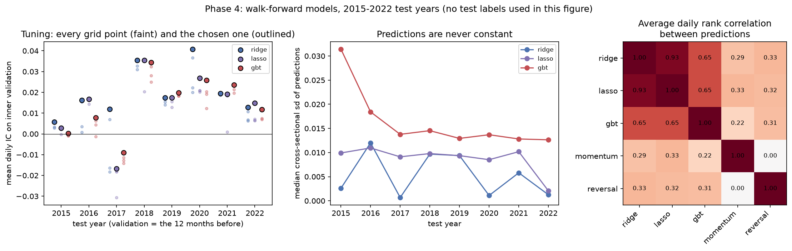

# Phase 4: models and out-of-sample predictions

Ridge, lasso and gradient-boosted trees (`HistGradientBoostingRegressor`) fitted walk-forward on 8 development folds; models, grids and the primary model (gbt) were pre-registered in [DESIGN.md](../DESIGN.md). Total run time 5 min.

## 1. Predictions saved for every test block

`predictions/dev_predictions.parquet`: one row per eligible stock and test date, with each model's and baseline's prediction, the raw and rank label, and the fold.

| Test year | Test dates | Dates with predictions | Stock-days | Missing predictions | Training rows (labelled) |
|---|---|---|---|---|---|
| 2015 | 252 | 252 | 112,594 | 0 | 213,181 |
| 2016 | 252 | 252 | 114,326 | 0 | 325,720 |
| 2017 | 251 | 251 | 115,702 | 0 | 439,932 |
| 2018 | 251 | 251 | 117,280 | 0 | 555,575 |
| 2019 | 252 | 252 | 118,136 | 0 | 672,805 |
| 2020 | 253 | 253 | 120,505 | 0 | 790,891 |
| 2021 | 252 | 252 | 121,264 | 0 | 911,301 |
| 2022 | 245 | 245 | 119,558 | 0 | 1,032,510 |

**Completeness: pass.** Every test date of every fold has a prediction from every model for every eligible stock (939,365 stock-days in total, 2015-01-02 to 2022-12-21).

## 2. Hyperparameters chosen per fold (inner validation, never the test year)

| Test year | ridge | lasso | gbt |
|---|---|---|---|
| 2015 | `{"alpha": 100000.0}` | `{"alpha": 1e-06}` | `{"max_leaf_nodes": 31, "min_samples_leaf": 2000}` |
| 2016 | `{"alpha": 1.0}` | `{"alpha": 0.0001}` | `{"max_leaf_nodes": 7, "min_samples_leaf": 2000}` |
| 2017 | `{"alpha": 1000000.0}` | `{"alpha": 0.0001}` | `{"max_leaf_nodes": 7, "min_samples_leaf": 200}` |
| 2018 | `{"alpha": 1000.0}` | `{"alpha": 1e-05}` | `{"max_leaf_nodes": 7, "min_samples_leaf": 2000}` |
| 2019 | `{"alpha": 1.0}` | `{"alpha": 1e-06}` | `{"max_leaf_nodes": 7, "min_samples_leaf": 200}` |
| 2020 | `{"alpha": 1000000.0}` | `{"alpha": 0.0001}` | `{"max_leaf_nodes": 7, "min_samples_leaf": 200}` |
| 2021 | `{"alpha": 100000.0}` | `{"alpha": 1e-05}` | `{"max_leaf_nodes": 7, "min_samples_leaf": 2000}` |
| 2022 | `{"alpha": 1000000.0}` | `{"alpha": 0.001}` | `{"max_leaf_nodes": 7, "min_samples_leaf": 200}` |

Inner-validation IC of the chosen setting (the 12 months before each test year; used for tuning only):

| Test year | ridge | lasso | gbt |
|---|---|---|---|
| 2015 | +0.0058 | +0.0028 | +0.0002 |
| 2016 | +0.0163 | +0.0168 | +0.0078 |
| 2017 | +0.0120 | -0.0166 | -0.0090 |
| 2018 | +0.0355 | +0.0355 | +0.0345 |
| 2019 | +0.0175 | +0.0175 | +0.0198 |
| 2020 | +0.0408 | +0.0268 | +0.0258 |
| 2021 | +0.0195 | +0.0192 | +0.0236 |
| 2022 | +0.0128 | +0.0148 | +0.0117 |

Average gap between the best and worst grid point on validation: ridge 0.0106, lasso 0.0091, gbt 0.0061. These gaps are about as large as the validation ICs themselves (0.00 to 0.04), so the choice of setting is noisy: ridge's alpha jumps between the ends of its grid from year to year. Phase 6 checks how much results depend on it.

## 3. Trial log (multiple testing)

`reports/trials.csv` records all 96 fits used for tuning (8 folds x 12 grid points), plus 24 refits and 2 baselines. Model families compared in Phase 5: 5. This count is what the Phase 5 multiple-testing adjustment uses. No other configurations were tried.

## 4. Sanity checks on the predictions (no test-year labels used)

Average daily rank correlation between the models' predictions:

| | ridge | lasso | gbt | momentum | reversal |
|---|---|---|---|---|---|
| ridge | +1.00 | +0.93 | +0.65 | +0.29 | +0.33 |
| lasso | +0.93 | +1.00 | +0.65 | +0.33 | +0.32 |
| gbt | +0.65 | +0.65 | +1.00 | +0.22 | +0.31 |
| momentum | +0.29 | +0.33 | +0.22 | +1.00 | +0.00 |
| reversal | +0.33 | +0.32 | +0.31 | +0.00 | +1.00 |

Median cross-sectional spread (sd) of predictions per date: ridge 0.0046, lasso 0.0095, gbt 0.0139. None is constant (a lasso that shrinks every weight to zero would show 0 here).

Figure: `scripts/make_phase4_figure.py` (tuning results per fold, prediction spread, agreement between models; no test labels used).
