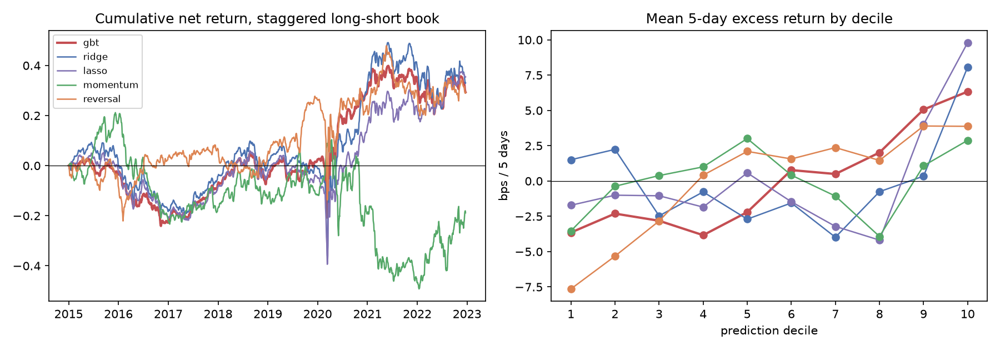
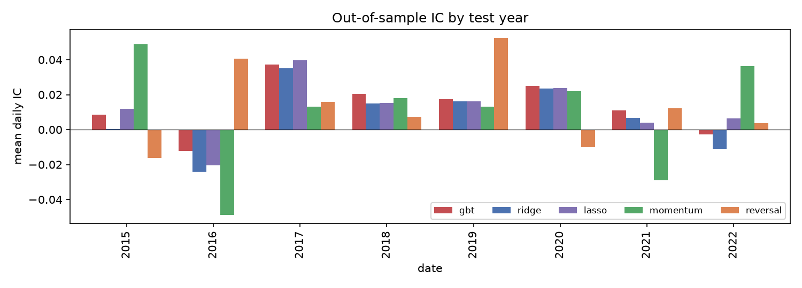

# Phase 5: evaluation (development test years 2015-2022)

Out-of-sample predictions from Phase 4 for 2,008 test dates (2015-01-02 to 2022-12-21), 939,365 stock-days. Metrics, portfolio rules and costs were pre-registered in [DESIGN.md](../DESIGN.md) before any of these numbers were computed. Hold-out (2023+) not used.

## 1. Information coefficient

Daily Spearman correlation between the signal and the next 5-day excess return. t-statistics use Newey-West standard errors (5 lags, labels overlap); p-values are Bonferroni-adjusted for the 5 signals.

| Signal | Mean IC | IC sd | IC-IR | t (NW) | p (Bonferroni) | Years positive | OOS R² (rank label) |
|---|---|---|---|---|---|---|---|
| gbt (primary) | +0.0132 | 0.143 | +0.092 | +2.29 | 0.110 | 6/8 | -0.00233 |
| ridge | +0.0078 | 0.196 | +0.040 | +0.97 | 1.000 | 6/8 | -0.00038 |
| lasso | +0.0121 | 0.171 | +0.071 | +1.76 | 0.394 | 7/8 | -0.00013 |
| momentum | +0.0091 | 0.240 | +0.038 | +0.93 | 1.000 | 6/8 | n/a |
| reversal | +0.0133 | 0.190 | +0.070 | +1.75 | 0.405 | 6/8 | n/a |

Mean IC by test year:

| Year | gbt | ridge | lasso | momentum | reversal |
|---|---|---|---|---|---|
| 2015 | +0.0085 | +0.0004 | +0.0118 | +0.0489 | -0.0161 |
| 2016 | -0.0122 | -0.0241 | -0.0205 | -0.0487 | +0.0406 |
| 2017 | +0.0374 | +0.0351 | +0.0398 | +0.0132 | +0.0158 |
| 2018 | +0.0205 | +0.0149 | +0.0153 | +0.0179 | +0.0074 |
| 2019 | +0.0175 | +0.0162 | +0.0162 | +0.0131 | +0.0525 |
| 2020 | +0.0251 | +0.0234 | +0.0237 | +0.0218 | -0.0100 |
| 2021 | +0.0111 | +0.0066 | +0.0041 | -0.0289 | +0.0122 |
| 2022 | -0.0026 | -0.0109 | +0.0064 | +0.0365 | +0.0038 |

## 2. Decile returns

Mean 5-day excess log return by prediction decile, in basis points (1 = lowest prediction):

| Decile | gbt | ridge | lasso | momentum | reversal |
|---|---|---|---|---|---|
| 1 | -3.6 | +1.5 | -1.7 | -3.5 | -7.6 |
| 2 | -2.3 | +2.2 | -1.0 | -0.4 | -5.3 |
| 3 | -2.8 | -2.5 | -1.0 | +0.4 | -2.8 |
| 4 | -3.8 | -0.8 | -1.8 | +1.0 | +0.4 |
| 5 | -2.2 | -2.7 | +0.6 | +3.0 | +2.1 |
| 6 | +0.8 | -1.6 | -1.5 | +0.4 | +1.6 |
| 7 | +0.5 | -4.0 | -3.2 | -1.1 | +2.4 |
| 8 | +2.0 | -0.8 | -4.2 | -3.9 | +1.5 |
| 9 | +5.1 | +0.3 | +4.0 | +1.1 | +3.9 |
| 10 | +6.3 | +8.1 | +9.8 | +2.9 | +3.9 |
| **10 − 1** | **+10.0** | **+6.6** | **+11.5** | **+6.4** | **+11.5** |
| Rank corr. with decile | +0.90 | +0.05 | +0.22 | +0.33 | +0.90 |

## 3. Long-short portfolios, net of costs

Top decile long, bottom decile short, equal weights, $1 each side, rebalanced every 5 days at the close after the signal (t+1), held 5 days. Costs: 3 bps + 30 bps/√(ADV in $m) one-way per stock (median stock ≈ 5.4 bps), short borrow 0.5% a year. Each figure is the average over 5 books started on consecutive days (range in brackets).

| Signal | Gross return | Net return | Net vol | Gross Sharpe | **Net Sharpe** | Net Sharpe 95% CI (avg) | Max drawdown | Turnover / rebalance | Cost drag / yr | Beta to SPY |
|---|---|---|---|---|---|---|---|---|---|---|
| gbt | +9.6% [+8.4%, +12.6%] | +3.7% [+2.5%, +6.6%] | 17.5% | +0.55 [+0.48, +0.64] | **+0.21 [+0.16, +0.31]** | [-0.49, +0.90] | -31.7% | 1.87 | 5.4% | +0.52 |
| ridge | +9.5% [+6.6%, +12.3%] | +4.1% [+1.3%, +6.9%] | 21.8% | +0.43 [+0.36, +0.52] | **+0.18 [+0.07, +0.29]** | [-0.51, +0.87] | -49.7% | 1.67 | 4.9% | +0.69 |
| lasso | +10.2% [+7.7%, +13.3%] | +4.4% [+1.9%, +7.5%] | 19.1% | +0.53 [+0.49, +0.58] | **+0.22 [+0.12, +0.33]** | [-0.47, +0.92] | -49.7% | 1.81 | 5.3% | +0.52 |
| momentum | -0.2% [-1.2%, +0.2%] | -2.4% [-3.3%, -2.0%] | 24.7% | -0.01 [-0.05, +0.01] | **-0.10 [-0.14, -0.07]** | [-0.79, +0.60] | -70.8% | 0.56 | 1.6% | -0.31 |
| reversal | +9.4% [+7.5%, +11.8%] | +3.7% [+1.8%, +6.0%] | 23.1% | +0.41 [+0.37, +0.45] | **+0.15 [+0.09, +0.23]** | [-0.54, +0.85] | -41.5% | 1.80 | 5.2% | +0.54 |

Turnover is the sum of absolute weight changes per rebalance (4.0 = the whole book replaced). Drawdowns are on cumulative (uncompounded) returns. Stock-weeks with a missing forward return (counted as 0): 13.

### Market exposure (diagnostic added after seeing the betas above; not pre-registered)

The books are dollar-neutral but not beta-neutral: they tend to buy higher-beta stocks than they short. Over the test years SPY returned about +11.2% a year (5-day simple returns, annualised), so part of the profit can be market exposure, not stock selection. Here each book is hedged with SPY using its beta at formation (the `beta_1y` feature, known at t; no future data), ignoring the small cost of trading SPY:

| Signal | Ex-ante book beta | Realised beta before hedge | Net return hedged | **Net Sharpe hedged** | 95% CI (avg) | Realised beta after hedge |
|---|---|---|---|---|---|---|
| gbt | +0.25 | +0.52 | +1.7% [+0.5%, +4.7%] | **+0.11 [+0.03, +0.26]** | [-0.58, +0.80] | +0.09 |
| ridge | +0.38 | +0.69 | +2.9% [+0.0%, +5.1%] | **+0.15 [+0.00, +0.27]** | [-0.55, +0.84] | +0.14 |
| lasso | +0.28 | +0.52 | +2.5% [+0.3%, +5.4%] | **+0.15 [+0.02, +0.27]** | [-0.55, +0.84] | +0.12 |
| momentum | -0.03 | -0.31 | -2.5% [-2.9%, -2.4%] | **-0.11 [-0.13, -0.10]** | [-0.80, +0.58] | -0.13 |
| reversal | -0.02 | +0.54 | +3.4% [+1.5%, +5.0%] | **+0.16 [+0.09, +0.20]** | [-0.53, +0.86] | +0.32 |

### Net return by year (staggered book, sum of 5-day net returns / 5)

| Year | gbt | ridge | lasso | momentum | reversal | gbt, SPY-hedged |
|---|---|---|---|---|---|---|
| 2015 | -3.6% | -0.3% | -2.7% | +17.9% | -8.1% | -5.4% |
| 2016 | -19.2% | -18.0% | -18.4% | -39.7% | +11.4% | -15.8% |
| 2017 | +15.3% | +14.0% | +12.5% | +4.6% | +3.5% | +7.0% |
| 2018 | +3.2% | +4.7% | +5.5% | +4.0% | -2.4% | +4.0% |
| 2019 | +6.7% | -1.5% | -1.7% | +1.5% | +21.8% | +0.5% |
| 2020 | +27.7% | +33.9% | +20.4% | -7.2% | -4.2% | +24.6% |
| 2021 | +3.6% | +6.4% | +6.5% | -27.7% | +6.2% | -7.7% |
| 2022 | -4.5% | -6.3% | +13.4% | +27.8% | +0.9% | +6.4% |

For gbt, 5 of 8 years are positive. The best two years (2020, 2017) add +43.0%; the other 6 together add -13.8% (total +29.2%). The result rests on a few years.

## 4. Signal decay

Mean IC against 5-day excess returns that start k trading days after the usual entry (close t+1+k to t+6+k):

| Start delay k (days) | gbt | ridge | lasso | momentum | reversal |
|---|---|---|---|---|---|
| 0 | +0.0132 | +0.0078 | +0.0121 | +0.0091 | +0.0133 |
| 5 | +0.0091 | +0.0057 | +0.0092 | +0.0079 | +0.0118 |
| 10 | +0.0076 | +0.0062 | +0.0091 | +0.0078 | +0.0086 |
| 20 | +0.0097 | +0.0090 | +0.0121 | +0.0085 | +0.0019 |

## 5. Verdict on the development period

- **Primary model (gbt):** mean IC +0.0132 (t = +2.29), **not significant** after the Bonferroni adjustment for 5 signals (p = 0.11). Its deciles rise almost steadily (rank correlation +0.90), but the out-of-sample R² is -0.0023: the predictions' size is not reliable, only their order is.
- **After costs:** net Sharpe +0.21, +0.11 once its market beta is hedged; every signal's 95% interval, hedged or not, includes 0. Costs take 5.4% a year from a gross 9.6%. Its turnover (1.87 per rebalance, out of a maximum 4) is close to the pure reversal baseline's (1.80), consistent with leaning on short-term reversal; Phase 6 importance checks this.
- **Compared with the baselines:** gbt's IC is about the same as plain 1-month reversal (+0.0133) and its hedged Sharpe is not higher. The machine-learning models have not shown value beyond the simplest baseline.
- **What this means:** in development there is weak evidence of an ordering signal and no evidence of a tradable edge after costs. The hold-out test (after Phase 6) is run once on the frozen pipeline regardless.

