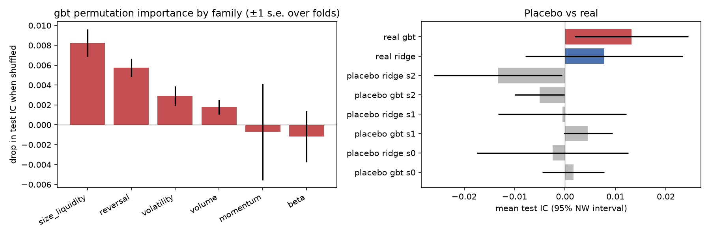

# Phase 6: robustness (development period 2015-2022)

Checks and pass/fail rules were pre-registered in [DESIGN.md](../DESIGN.md) before any of them ran. Every result is shown, including failures. The hold-out is still untouched.

## 0. Reproducibility

Refitting gbt on every fold with the settings Phase 4 chose reproduces the saved predictions: max absolute difference 0.0e+00 (pass; predictions are stored as float32). The refitted models are used for the importance test below.

## 1. Placebo: models trained on shuffled labels

Within every training date the label is shuffled across stocks, so features carry no information about it. The same models and settings are refitted and scored on the real test labels. **Pass:** mean IC within 2 Newey-West standard errors of 0.

| Seed | Model | Mean test IC | t (NW) | Gross Sharpe of its long-short book | Result |
|---|---|---|---|---|---|
| 0 | gbt | +0.0017 | +0.54 | +0.13 | pass |
| 0 | ridge | -0.0024 | -0.32 | +0.08 | pass |
| 1 | gbt | +0.0046 | +1.87 | +0.48 | pass |
| 1 | ridge | -0.0005 | -0.08 | +0.30 | pass |
| 2 | gbt | -0.0050 | -2.01 | -0.77 | FAIL |
| 2 | ridge | -0.0133 | -2.05 | -0.54 | FAIL |

4 of 6 placebo runs pass. For comparison, the real models' mean IC: gbt +0.0132, ridge +0.0078.

## 2. Future perturbation of the whole pipeline

Every price after 2018-06-29 is multiplied by random noise (5% sd) and volumes by noise (30% sd). Cleaning, features, labels and the whole 2018 fold (tuning included) are then rerun. **Pass:** predictions up to that date are unchanged, and later ones change.

| Model | Hyperparameters chosen (original / perturbed) | Max diff, test dates ≤ cut-off | Max diff, after | Result |
|---|---|---|---|---|
| gbt | `{'max_leaf_nodes': 7, 'min_samples_leaf': 2000}` / `{'max_leaf_nodes': 7, 'min_samples_leaf': 2000}` | 0.0e+00 | 8.8e-02 | pass |
| ridge | `{'alpha': 1000.0}` / `{'alpha': 1000.0}` | 6.9e-18 | 3.2e-02 | pass |

Features for every date up to the cut-off are also identical (max difference over all 12 features 0.0e+00). **Pass.**

**Known gap this test cannot see:** the cleaning rule that drops placeholder history before a listing (Phase 1) looks at each stock's whole history. For SW, FERG and AMCR it removes years of untraded prices that a trader at the time would also have seen as untraded, and none of the three was an index member then, so the effect is part of the membership look-ahead already stated, not a separate leak.

## 3. What the primary model relies on

Permutation importance: the drop in each fold's test IC when one feature family is shuffled across stocks within each date (average of 2 shuffles). A large drop means the model's skill depends on that family; a negative drop means the family was hurting.

| Test year | Base IC | momentum | reversal | volatility | beta | volume | size_liquidity |
|---|---|---|---|---|---|---|---|
| 2015 | +0.0085 | +0.0070 | +0.0018 | +0.0047 | -0.0018 | +0.0006 | +0.0028 |
| 2016 | -0.0122 | -0.0305 | +0.0050 | +0.0001 | -0.0028 | +0.0023 | +0.0087 |
| 2017 | +0.0374 | +0.0050 | +0.0078 | +0.0052 | +0.0097 | +0.0037 | +0.0090 |
| 2018 | +0.0205 | +0.0048 | +0.0057 | +0.0057 | -0.0012 | -0.0014 | +0.0068 |
| 2019 | +0.0175 | +0.0014 | +0.0104 | +0.0022 | -0.0015 | -0.0004 | +0.0134 |
| 2020 | +0.0251 | +0.0112 | +0.0039 | +0.0049 | +0.0021 | +0.0041 | +0.0094 |
| 2021 | +0.0111 | -0.0111 | +0.0068 | +0.0024 | +0.0024 | +0.0039 | +0.0128 |
| 2022 | -0.0026 | +0.0065 | +0.0047 | -0.0021 | -0.0163 | +0.0014 | +0.0031 |
| **Mean** | +0.0131 | **-0.0007** | **+0.0058** | **+0.0029** | **-0.0012** | **+0.0018** | **+0.0083** |
| Folds with a positive drop | | 6/8 | 8/8 | 7/8 | 3/8 | 6/8 | 8/8 |

Ranking by mean drop: size_liquidity (+0.0083), reversal (+0.0058), volatility (+0.0029), volume (+0.0018), momentum (-0.0007), beta (-0.0012).

Ridge coefficients per fold (x 1000; features are ranks in [-0.5, 0.5], so they are comparable):

| Feature | 2015 | 2016 | 2017 | 2018 | 2019 | 2020 | 2021 | 2022 | Same sign in all folds |
|---|---|---|---|---|---|---|---|---|---|
| mom_12_1 | +2.53 | +36.72 | +0.39 | +4.99 | +5.95 | +0.72 | +5.41 | +0.66 | yes |
| mom_6_1 | +1.91 | -5.78 | +0.44 | +10.39 | +14.59 | +0.69 | +3.49 | +0.61 | no |
| rev_1m | -1.12 | +1.15 | -0.35 | -7.10 | -2.17 | -1.03 | -4.59 | -0.98 | no |
| rev_1w | -1.61 | -11.04 | -0.34 | -8.59 | -13.41 | -0.85 | -5.13 | -0.99 | yes |
| high_52w | -1.03 | -0.50 | -0.21 | -3.19 | -3.75 | -0.42 | -0.87 | -0.50 | yes |
| vol_1m | +1.75 | -1.86 | +0.21 | -4.79 | -3.98 | +0.57 | +1.70 | +0.63 | no |
| vol_3m | +1.81 | -21.88 | +0.38 | -7.67 | -26.64 | +0.59 | +2.15 | +0.75 | no |
| beta_1y | +1.76 | +3.53 | +0.25 | +11.58 | +10.93 | +0.63 | +3.13 | +0.92 | yes |
| idio_vol_3m | +1.85 | +20.81 | +0.38 | +12.34 | +27.65 | +0.57 | +2.90 | +0.67 | yes |
| volume_trend | -2.77 | -11.89 | -0.48 | -12.78 | -8.62 | -0.56 | -4.35 | -0.81 | yes |
| amihud_1m | +1.92 | +19.75 | +0.80 | +18.25 | +27.27 | +1.21 | +5.54 | +1.37 | yes |
| size_proxy | -1.33 | +2.62 | -0.70 | -2.38 | +8.11 | -1.04 | -4.90 | -1.19 | no |

## 4. Sensitivity

### 4a. Label horizon (models retrained and retuned for each horizon; embargo = h; rebalance every h days)

| Horizon | Model | Mean IC | t (NW) | Gross Sharpe | Net Sharpe | Net Sharpe 95% CI | Hedged net Sharpe | Turnover / rebalance |
|---|---|---|---|---|---|---|---|---|
| 1 days | gbt | +0.0087 | +2.84 | +0.34 | -1.04 | [-1.74, -0.35] | -1.16 | 1.48 |
| 1 days | ridge | +0.0121 | +3.11 | +0.43 | -0.26 | [-0.95, +0.43] | -0.21 | 0.81 |
| 5 days (pre-registered) | gbt | +0.0132 | +2.29 | +0.55 | +0.21 | [-0.49, +0.90] | +0.11 | 1.87 |
| 5 days (pre-registered) | ridge | +0.0078 | +0.97 | +0.43 | +0.18 | [-0.51, +0.87] | +0.15 | 1.67 |
| 21 days | gbt | +0.0218 | +3.12 | +0.60 | +0.47 | [-0.23, +1.17] | +0.39 | 2.07 |
| 21 days | ridge | +0.0162 | +1.72 | +0.60 | +0.51 | [-0.19, +1.21] | +0.36 | 1.66 |

The t-statistics use 5 Newey-West lags for every horizon; for h = 21 the labels overlap for 21 days, so its t-statistic is overstated.

### 4b. Hyperparameters held fixed for all folds (no tuning)

| Model | Setting | Mean IC | t (NW) | Net Sharpe | Hedged net Sharpe |
|---|---|---|---|---|---|
| gbt | `{'max_leaf_nodes': 7, 'min_samples_leaf': 200}` | +0.0127 | +2.16 | +0.25 | +0.16 |
| gbt | `{'max_leaf_nodes': 7, 'min_samples_leaf': 2000}` | +0.0112 | +1.92 | +0.21 | +0.13 |
| gbt | `{'max_leaf_nodes': 31, 'min_samples_leaf': 200}` | +0.0086 | +1.69 | +0.11 | -0.04 |
| gbt | `{'max_leaf_nodes': 31, 'min_samples_leaf': 2000}` | +0.0101 | +2.14 | +0.15 | +0.01 |
| ridge | `{'alpha': 1.0}` | +0.0112 | +1.54 | +0.19 | +0.16 |
| ridge | `{'alpha': 1000.0}` | +0.0116 | +1.58 | +0.18 | +0.16 |
| ridge | `{'alpha': 100000.0}` | +0.0141 | +1.85 | +0.36 | +0.29 |
| ridge | `{'alpha': 1000000.0}` | +0.0133 | +1.64 | +0.38 | +0.28 |
| gbt | **tuned per fold (Phase 4)** | +0.0132 | +2.29 | +0.21 | +0.11 |
| ridge | **tuned per fold (Phase 4)** | +0.0078 | +0.97 | +0.18 | +0.15 |

Tuning versus the best fixed gbt setting with hindsight ({'max_leaf_nodes': 7, 'min_samples_leaf': 200}, net Sharpe +0.25): choosing it after seeing these test results would be data snooping, which is why the tuned result is the one reported.

### 4c. Costs and portfolio breadth (gbt)

| Variant | Gross Sharpe | Net Sharpe | Net Sharpe 95% CI | Hedged net Sharpe | Turnover |
|---|---|---|---|---|---|
| costs x0 | +0.55 | +0.52 | [-0.17, +1.22] | +0.49 | 1.87 |
| costs x0.5 | +0.55 | +0.36 | [-0.33, +1.06] | +0.30 | 1.87 |
| costs x1 | +0.55 | +0.21 | [-0.49, +0.90] | +0.11 | 1.87 |
| costs x2 | +0.55 | -0.11 | [-0.81, +0.58] | -0.27 | 1.87 |
| top/bottom 20% (costs x1) | +0.57 | +0.18 | [-0.51, +0.88] | +0.11 | 1.57 |

### 4d. Universe: membership look-ahead (gbt, same predictions, deciles formed within each group)

| Stocks | Mean IC | t (NW) | Net Sharpe | Hedged net Sharpe |
|---|---|---|---|---|
| all (Phase 5) | +0.0132 | +2.29 | +0.21 | +0.11 |
| members since 2012 or earlier (297 stocks) | +0.0033 | +0.52 | -0.17 | -0.35 |
| joined after 2012 (the rest) | +0.0191 | +3.52 | +0.46 | +0.42 |

## 5. Summary

| Check | Result |
|---|---|
| Reproducibility of Phase 4 predictions | pass |
| Placebo (shuffled labels), 6 runs | 4/6 pass |
| Future perturbation of the whole pipeline | pass |
| Most important feature family (gbt) | size_liquidity (mean IC drop +0.0083), then reversal (+0.0058) |
| Signal on stocks in the index since 2012 or earlier | IC +0.0033 (t +0.52) vs +0.0191 (t +3.52) on later joiners |
| Any variant with a net Sharpe 95% CI above 0 (excluding zero-cost runs) | none |

## 6. Interpretation (written after seeing the results above; pass/fail outcomes are unchanged)

- **The placebo failures are not leakage.** Both failing runs are *negative* (leakage would push them up), and the future-perturbation test of the whole pipeline passes exactly. They show something else: a model fitted to shuffled labels is not a constant but a random mix of features, i.e. a random factor portfolio, and factor returns persist for months. Its IC therefore wanders further from 0 than 5-lag Newey-West errors allow. Placebo ICs ranged from -0.0133 to +0.0046; the largest in size (0.0133) is as large as the real gbt IC (+0.0132). The t-statistics in Phase 5 understate the uncertainty, and the real result is not clearly separated from what noise-fitted models produce.
- **The signal sits in the stocks affected by membership look-ahead.** On stocks already in the index by 2012 the IC is +0.0033 (t +0.52); on stocks that joined later it is +0.0191 (t +3.52). The most important feature family is size and liquidity, and ridge puts a positive weight on illiquidity in every fold: the model favours smaller, less liquid stocks, and in a universe of today's members those include the ones that went on to grow into the index. Later joiners may also simply be more predictable (smaller, less covered), so the split cannot prove the cause, but it removes the evidence of an edge in the stocks where the data are free of this bias.
- **Costs and horizon:** the gross Sharpe is about +0.55; costs at the assumed level remove most of it and double costs make it negative. Daily trading loses money (gbt: the whole 95% interval is below 0); a 21-day horizon looks better but its interval still includes 0, and choosing it now would be data snooping.
- **Conclusion for the hold-out:** the frozen, pre-registered pipeline (h = 5, gbt primary) runs once as planned. Given the above, the expectation is an IC near zero and no net edge; the hold-out also reports the members-since-2012 split.

