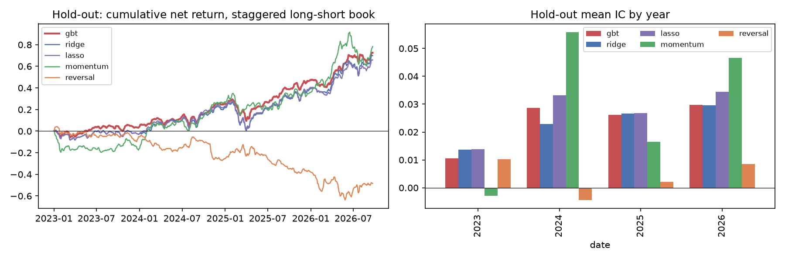

# Phase 7: hold-out (2023 - Sep 2026), single run of the frozen pipeline

Pipeline frozen at commit `1b30cb4` after Phase 6 (the script checks that `src/alpha/` is identical). First run: 2026-10-15T08:07:33+00:00 UTC; this run: 2026-10-15T08:11:36+00:00 UTC. Same models, tuning, portfolio and costs as pre-registered; nothing was changed after seeing these numbers.

933 test dates (2023-01-03 to 2026-09-22), 461,435 stock-days, 4 yearly folds (each trained on all earlier data).

Hyperparameters chosen on each fold's inner validation: 2023 gbt `{"max_leaf_nodes": 7, "min_samples_leaf": 2000}`; 2023 ridge `{"alpha": 1.0}`; 2023 lasso `{"alpha": 1e-06}`; 2024 gbt `{"max_leaf_nodes": 7, "min_samples_leaf": 2000}`; 2024 ridge `{"alpha": 1000000.0}`; 2024 lasso `{"alpha": 0.0001}`; 2025 gbt `{"max_leaf_nodes": 7, "min_samples_leaf": 2000}`; 2025 ridge `{"alpha": 1.0}`; 2025 lasso `{"alpha": 1e-06}`; 2026 gbt `{"max_leaf_nodes": 7, "min_samples_leaf": 200}`; 2026 ridge `{"alpha": 1000000.0}`; 2026 lasso `{"alpha": 0.0001}`.

## 1. Signal quality

| Signal | Hold-out mean IC | t (NW) | p (Bonferroni, 5) | Hold-out OOS R² | Development mean IC (Phase 5) |
|---|---|---|---|---|---|
| gbt (primary) | +0.0233 | +2.46 | 0.069 | +0.00071 | +0.0132 |
| ridge | +0.0227 | +1.94 | 0.263 | +0.00031 | +0.0078 |
| lasso | +0.0265 | +2.28 | 0.114 | +0.00076 | +0.0121 |
| momentum | +0.0278 | +2.21 | 0.137 | n/a | +0.0091 |
| reversal | +0.0038 | +0.37 | 1.000 | n/a | +0.0133 |

Mean IC by hold-out year:

| Year | gbt | ridge | lasso | momentum | reversal |
|---|---|---|---|---|---|
| 2023 | +0.0105 | +0.0137 | +0.0138 | -0.0029 | +0.0103 |
| 2024 | +0.0286 | +0.0228 | +0.0332 | +0.0559 | -0.0044 |
| 2025 | +0.0262 | +0.0266 | +0.0268 | +0.0164 | +0.0022 |
| 2026 (to Sep) | +0.0297 | +0.0296 | +0.0344 | +0.0466 | +0.0086 |

Top-minus-bottom decile, mean 5-day excess return (bps): gbt +39.4, ridge +34.2, lasso +34.5, momentum +39.2, reversal -14.7.

## 2. Long-short portfolios net of costs (same rules as Phase 5; average of 5 staggered books)

| Signal | Gross Sharpe | **Net Sharpe** | Net Sharpe 95% CI | Net return / yr | Hedged net Sharpe | Turnover |
|---|---|---|---|---|---|---|
| gbt | +1.32 | **+1.05** | [+0.02, +2.07] | +19.6% | +0.59 | 1.88 |
| ridge | +1.08 | **+0.86** | [-0.17, +1.88] | +18.9% | +0.30 | 1.77 |
| lasso | +1.08 | **+0.83** | [-0.19, +1.85] | +17.8% | +0.23 | 1.94 |
| momentum | +0.83 | **+0.77** | [-0.25, +1.79] | +21.1% | +0.56 | 0.53 |
| reversal | -0.39 | **-0.61** | [-1.63, +0.41] | -13.1% | -0.53 | 1.75 |

## 3. Membership look-ahead split (as in Phase 6)

| Stocks | gbt mean IC | t (NW) | Net Sharpe | Hedged net Sharpe |
|---|---|---|---|---|
| members since 2012 or earlier | +0.0185 | +1.85 | +0.57 | -0.10 |
| joined after 2012 | +0.0279 | +3.18 | +1.40 | +1.17 |
| all | +0.0233 | +2.46 | +1.05 | +0.59 |

## 4. Verdict

- **Primary model (gbt):** hold-out mean IC +0.0233 (t +2.46, Bonferroni p 0.07); net Sharpe +1.05 [+0.02, +2.07], +0.59 hedged. The interval excludes 0.
- **Against the baselines:** reversal IC +0.0038, momentum +0.0278.
- Phase 6 showed that t-statistics understate the uncertainty (placebo runs) and that the development signal sat in later index joiners; read these numbers with both in mind.

## 5. Interpretation (added after the first run; the numbers above are unchanged)

The universe is the index as of October 2026, so it includes stocks that joined *during* the hold-out, and they joined because they rose during it. Splitting the hold-out by when each stock joined:

| Stocks | Count | Mean 5-day excess return | gbt IC | t (NW) | momentum IC |
|---|---|---|---|---|---|
| in the index before 2013 | 297 | -4.0 bps | +0.0185 | +1.85 | +0.0278 |
| joined 2013-2022 | 141 | -7.7 bps | +0.0127 | +1.50 | +0.0058 |
| joined during the hold-out (2023 on) | 61 | +40.2 bps | +0.0430 | +3.71 | +0.0435 |

- **The hold-out result is inflated by membership look-ahead.** The stocks that joined during the hold-out outperform the rest by construction, and the model's IC on them is +0.0430, against +0.0185 (t +1.85) on stocks that were members throughout. On those long-time members the long-short book's market-hedged net Sharpe is negative (section 3).
- **The market regime helped momentum-like signals:** plain 12-month momentum did about as well as the model (IC +0.0278), and short-term reversal, which the model also relies on, did not work.
- **The net Sharpe interval only just excludes 0** (lower end +0.02), and Phase 6's placebo runs showed these intervals are too narrow.
- **Overall:** the hold-out does not show a tradable edge that survives the known biases. A clean test needs point-in-time index membership (e.g. CRSP), which this project could not obtain for free.

